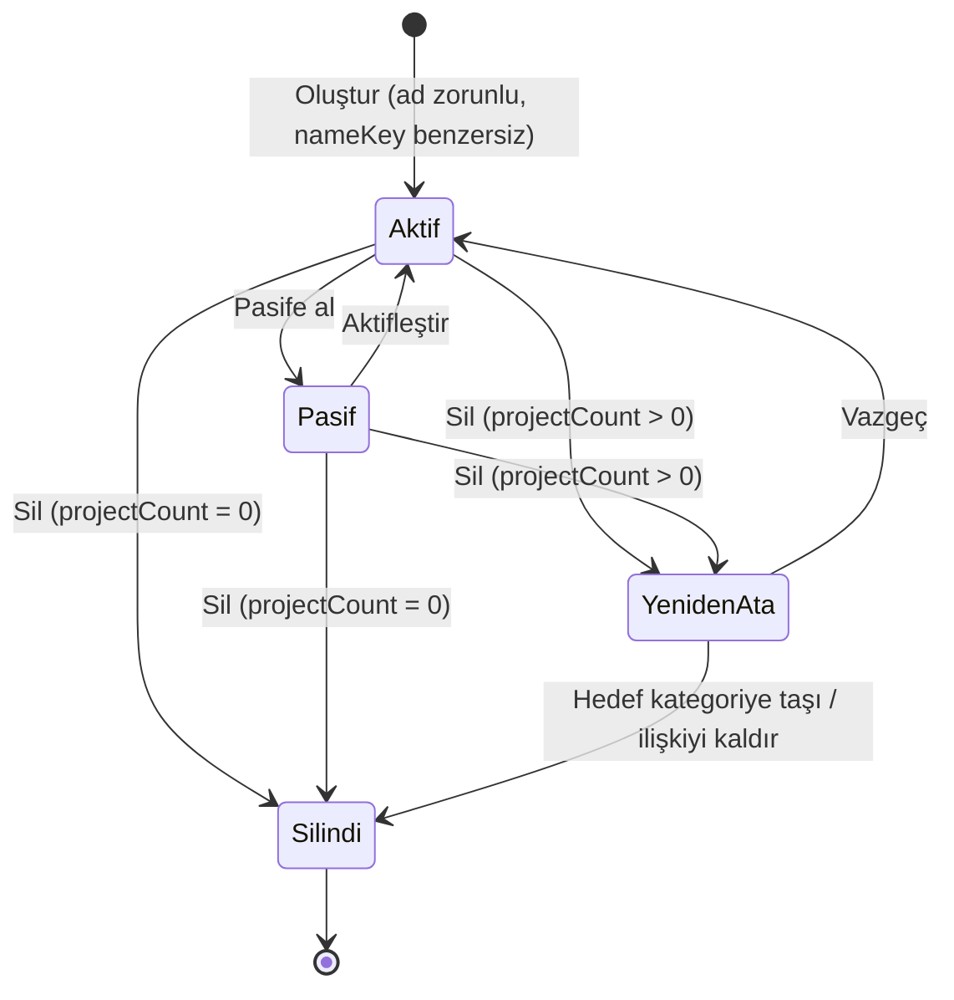

# CMS — İçerik Yönetim Sistemi

> **Sürüm:** 1.0 · **Son güncelleme:** 2026-11-14 · Bağlı: DATABASE.md, ROUTES.md §4, ADMIN.md
> **Uyarlama notu:** Şablondaki "müfredat ders/konu tanımlama" bu projede **içerik taksonomisi (kategori ↔ proje)** olarak; "WhatsApp şablon motoru" ise **genel e-posta şablon motoru** (bildirimler + `mailto:` yanıt linki) olarak karşılanmıştır. **WhatsApp entegrasyonu yoktur** (2026-11-15 kararı: `wa.me` hızlı yanıtı dahil kaldırıldı; telefon numarasıyla otomatik ya da yarı otomatik iletişim kurulmaz). Hiçbir mesaj otomatik gönderilmez.

---

## 1. İçerik envanteri

Public sitedeki her parça bir CMS kaynağına bağlıdır. Sabit metin yalnızca "sistem metinleri" (§7) ve Tech Stack placeholder'ıdır.

| Public parça | CMS kaynağı | Admin ekranı | Boşsa |
|---|---|---|---|
| Navbar başlığı | `SiteSettings.navbarTitle` | Site Ayarları | Varsayılan `vasquez` |
| Favicon | `SiteSettings.faviconAssetId` | Site Ayarları | `/favicon.ico` (build varsayılanı) |
| Hero (isim, slogan, konum, efektler) | `HeroSettings` | Hero Section | İsim boşsa navbarTitle |
| Hero profil görseli | Rotasyon PFP / `fixedProfileMediaId` | Hero Section + Site Ayarları | Baş harf avatarı |
| Sahne arka planı | Rotasyon BACKGROUND | Medya > Arka planlar | Gradyan fallback |
| Müzik | Rotasyon MUSIC | Medya > Müzikler | Oynatıcı yok |
| İmleç | Rotasyon CURSOR | Medya > Cursor setleri | Sistem imleci |
| Durum kartları | `IntegrationSetting` | Durumlar | Kart yok |
| Tech Stack bölümleri | `TechStackGroup` (başlık, yayın, sıra) + `TechStackItem` (bölüm başına) | Tech Stack (admin; bölüm sekmeleri) | Hiçbir bölüm yayında değilse Tech Stack ile ilgili hiçbir şey gösterilmez (2026-11-17); yayındaki her bölüm ayrı halka |
| Projeler | `Project` + `Category` | Projeler / Kategoriler | Bölüm yok |
| Hakkımda | `AboutContent` | Site Ayarları | Bölüm yok |
| Linkler | `LinkItem` | Linkler | Bölüm yok |
| İletişim formu | Sabit form + `LegalDocument(KVKK_NOTICE)` linki | Sistem > Yasal metinler | Form her zaman var |
| İsim GIF katmanı | `NameOverlay` (rotasyon `NAME_OVERLAY`) | Medya > İsim efektleri | Katman yok |
| Yağan öğeler | `FallingItem` | Hero Section > Yağan öğeler | Yağış yok |
| Footer teknolojileri | `SiteSettings.footerTechs` | Site Ayarları | Liste gizli, yalnızca © satırı |
| © satırı | `© {yıl} {HeroSettings.displayName}` | — (türetilir) | navbarTitle |
| Duvar kağıtları | `Background (isWallpaper)` | Medya > Arka planlar → "Duvar kağıdı" anahtarı | Navbar linki yok |
| Profil fotoğrafları (indirme) | `ProfileMedia (isDownloadable)` | Medya > Profil fotoğrafları | Navbar linki yok |
| KVKK / Çerez politikası | `LegalDocument` | Sistem > Yasal metinler | Taslak metin (seed) |

---

## 2. Yayın durumu modeli

Her içerik türü için public görünürlük tek bir kural fonksiyonuyla hesaplanır (`modules/public/visibility.js`). Bu fonksiyon hem liste hem navbar bayrağı hem medya sunumu tarafından kullanılır — tek kaynak.

| Tür | Public görünür | İndirilebilir | Rotasyona uygun |
|---|---|---|---|
| ProfileMedia | `isActive ∧ READY` | `isActive ∧ isDownloadable ∧ READY` | `isActive ∧ rotationEnabled ∧ READY` |
| Background | (yalnızca seçilince) | — | `isActive ∧ rotationEnabled ∧ READY` |
| Music | (yalnızca seçilince) | — | `isActive ∧ rotationEnabled ∧ audio.READY ∧ cover.READY` |
| CursorSet | (yalnızca seçilince) | — | `isActive ∧ rotationEnabled ∧ normal.READY ∧ click.READY` |
| Project | `isPublished` | — | — |
| Category | `isActive ∧ yayındaki ≥1 projede` | — | — |
| LinkItem | `isActive ∧ image.READY` | — | — |

Admin arayüzünde her kayıt satırında bu hesaplanmış durum rozet olarak gösterilir: **Yayında**, **Gizli**, **İşleniyor**, **Hata**, **Bugün seçili**, **Manuel seçim**.

> Override (manuel seçim) yalnızca `isActive ∧ READY` içerikle yapılabilir; `rotationEnabled = false` olan içerik de manuel seçilebilir (rotasyon dışı ama elle kullanılabilir).

---

## 3. İçerik taksonomisi — Kategori ve Proje tanımlama

### 3.1 Kategori yaşam döngüsü



- Sistem **hiçbir varsayılan kategori oluşturmaz** (Şartname §7.1).
- Pasif kategori, public proje kartlarında ve filtrelerde görünmez; proje ilişkisi korunur.
- Ad değişikliği `nameKey`'i yeniden hesaplar; çakışma → `409` "Bu adla bir kategori zaten var."
- Sıralama sürükle-bırak; public filtre çipleri bu sırayla dizilir.

### 3.2 Proje editörü

Bölümler (tek sayfa, solda form, sağda canlı kart önizlemesi):

1. **Temel:** Başlık (zorunlu, ≤ 120), Slug (başlıktan otomatik; "kilitle" anahtarı ile manuel; anlık `slug-check`).
2. **Açıklama:** Markdown editörü (§4) — zorunlu, ≤ 20 000. Kart özeti otomatik: ilk paragrafın düz metni, 160 karakter.
3. **Görseller:** Çoklu yükleme (sürükle-bırak alanı, her dosya için ayrı ilerleme çubuğu), sıralama (ilk görsel = kapak), alt metin alanı (boşsa başlık kullanılır).
4. **Kategoriler:** Çoklu seçim (aranabilir combobox; içinden "+ Yeni kategori" kısayolu → aynı modal).
5. **Bağlantılar:** Demo, Video, GitHub — en az biri zorunlu; hata mesajı üç alanın üstünde grup hatası olarak: "En az bir bağlantı girmelisin: Demo, Video veya GitHub."
6. **Yayın:** Yayında anahtarı, sıralama değeri. Yayına ilk alındığında `publishedAt` set edilir.

Doğrulama kuralları `packages/shared/validation/project.js` içinde tek şemadadır (istemci + sunucu).

### 3.3 Projeler ekranı (liste)

Üstte iki birincil buton: **Kategori Oluştur** (modal) ve **Proje Oluştur** (editöre gider) — Şartname §15.8. Tablo: kapak küçük resmi, başlık, kategoriler, durum, görüntülenme, güncellenme, sıralama tutamacı, eylemler.

---

## 4. Zengin metin (Markdown) politikası

- Saklama biçimi: **Markdown** (HTML değil).
- Editör: textarea tabanlı, araç çubuğu (kalın, italik, başlık H2–H3, liste, alıntı, link, satır içi kod), "Önizleme" sekmesi — önizleme public render ile **aynı** `SafeMarkdown` bileşenini kullanır.
- İzinli öğeler: `p, h2, h3, strong, em, ul, ol, li, blockquote, a, code, pre, hr, br`. `h1` yok (sayfada tek h1 hero ismidir). Görsel (`img`) **yok** (v1).
- Linkler: yalnızca `http:`, `https:`, `mailto:`; render'da harici linklere `target="_blank" rel="noopener noreferrer"`.
- Raw HTML: `react-markdown` varsayılanı (escape) + `rehype-sanitize` (savunma derinliği). `rehype-raw` **kullanılmaz**.
- Sunucu tarafı: kaydederken uzunluk ve kontrol karakteri temizliği (`\u0000–\u0008` vb.); HTML'e dönüştürülmez.

---

## 5. Sistem şablonları ve şablon motoru

### 5.1 Şablon kayıtları

`MessageTemplate` tablosu; seed ile oluşturulur, `isSystem = true` (silinemez, "Varsayılana sıfırla" yapılabilir).

| Key | Kanal | Ne zaman | Değişkenler |
|---|---|---|---|
| `PASSWORD_RESET` | EMAIL | Şifremi unuttum | `siteName`, `adminName`, `resetUrl`, `expiresInMinutes` |
| `CONTACT_NOTIFICATION` | EMAIL | Yeni iletişim mesajı (opsiyonel) | `siteName`, `senderFullName`, `senderEmail`, `senderPhone`, `subject`, `message`, `adminUrl` |
| `SMTP_TEST` | EMAIL | Bağlantı testi | `siteName`, `sentAt` |
| `CONTACT_REPLY_EMAIL` | EMAIL (mailto) | "E-posta ile yanıtla" | `siteName`, `ownerName`, `firstName`, `lastName`, `subject` |

### 5.2 Motor kuralları (`backend/src/mail/templateEngine.js`)

- Sözdizimi: yalnızca `{{degisken}}` (boşluklara tolerans: `{{ degisken }}`). **Mantık, döngü, helper, partial yok** — şablon, kod çalıştıramaz.
- Değişken adı regex'i: `^[a-zA-Z][a-zA-Z0-9]*$`.
- **Kayıt anında doğrulama:** şablondaki her değişken, o key'in izinli listesinde olmalı; değilse `422` "Bilinmeyen değişken: {{x}}". Zorunlu değişkenler (ör. `PASSWORD_RESET` için `resetUrl`) şablonda yoksa kayıt reddedilir.
- **Kanal bazlı kaçış (escaping):**

| Hedef | Kaçış |
|---|---|
| E-posta konusu | CR/LF kaldırılır (header injection önlemi), ≤ 200 karakter |
| E-posta düz metin gövdesi | Ham değer (kontrol karakterleri temizlenir) |
| E-posta HTML gövdesi | Her değer HTML-escape; gövde `\n` → `<br>`; şablonun kendisi de escape edilir (admin HTML yazamaz), ardından sabit marka HTML çerçevesine yerleştirilir |
| mailto `subject`/`body` | `encodeURIComponent` |

- Eksik değişken değeri → boş string; render sonucu loglanmaz (kişisel veri içerebilir).
- Önizleme endpoint'i sabit örnek değerlerle render eder (gerçek kullanıcı verisi kullanmaz).

### 5.3 Varsayılan metinler (seed)

**PASSWORD_RESET**
```
Konu: {{siteName}} — Şifre sıfırlama
Merhaba {{adminName}},
Yönetim paneli için bir şifre sıfırlama isteği aldık. Aşağıdaki bağlantı {{expiresInMinutes}} dakika geçerlidir ve yalnızca bir kez kullanılabilir:
{{resetUrl}}
Bu isteği sen yapmadıysan bu e-postayı yok sayabilirsin; şifren değişmeyecek.
```

**CONTACT_NOTIFICATION**
```
Konu: {{siteName}} — Yeni mesaj: {{subject}}
{{senderFullName}} ({{senderEmail}}, {{senderPhone}}) yeni bir mesaj gönderdi:
{{message}}
Panelde görüntüle: {{adminUrl}}
```

**SMTP_TEST**
```
Konu: {{siteName}} — SMTP testi
Bu bir test e-postasıdır. Gönderim zamanı: {{sentAt}}. E-posta ayarların çalışıyor.
```

**CONTACT_REPLY_EMAIL**
```
Konu: Re: {{subject}}
Merhaba {{firstName}},
{{siteName}} üzerinden gönderdiğin mesaj için teşekkürler.

{{ownerName}}
```

### 5.4 E-posta gönderim kuralları

- Transport: `nodemailer`, `MailSettings`'ten; `appPasswordEnc` yalnızca gönderim anında çözülür.
- Zaman aşımı: bağlantı 10 sn, gönderim 20 sn. Başarısızlık kullanıcı akışını bozmaz (forgot-password yine 202).
- `From`: `"{fromName}" <{fromEmail}>`; `Reply-To` iletişim bildiriminde gönderenin e-postası (doğrulanmış biçimde).
- Her e-posta hem `text` hem `html` parçası içerir.

---

## 6. WhatsApp hızlı yanıt — KALDIRILDI

2026-11-15 kararıyla kapsam dışı: `wa.me` linki, özellik anahtarı ve `CONTACT_REPLY_WHATSAPP` şablonu yok. Admin yanıtı yalnızca "E-posta ile yanıtla" (`mailto:`) ile verir. Veritabanındaki `TemplateKey.CONTACT_REPLY_WHATSAPP` / `TemplateChannel.WHATSAPP` enum değerleri ve eski seed satırı kullanılmaz; kaldırılmaları ayrı bir migration ile yapılır (onay gerektirir).

---

## 7. Sistem metinleri (kodda sabit)

Bu metinler içerik değil arayüz metnidir; `frontend/src/lib/copy.js` dosyasında tek yerde tutulur (ileride i18n'e taşınabilir):

| Anahtar | Metin |
|---|---|
| welcome.prompt | `Welcome, click to enter...` (Şartname gereği İngilizce) |
| ~~techstack.placeholder~~ | Kaldırıldı (2026-11-17): yayında bölüm yoksa yer tutucu da gösterilmez |
| links.title | `Linkler` |
| downloads.disclaimer | `İndirdiğiniz içeriklerden sorumluluk kabul etmiyoruz.` |
| wallpapers.title | `Duvar kağıtlarını beğendin mi? Ücretsiz alabilirsin.` |
| downloads.empty | `Şu anda indirilebilir içerik yok.` |
| spotify.idle | `Şu anda müzik dinlemiyor` |
| login.title | `Hoşgeldiniz...` |
| contact.success | `Mesajın ulaştı. En kısa sürede dönüş yapacağım.` |
| contact.error | `Mesaj gönderilemedi. Lütfen biraz sonra tekrar dene.` |
| generic.error | `Bir şeyler ters gitti. Sayfayı yenilemeyi dene.` |

Metin tonu: samimi "sen" dili (public), net ve kısa (admin). Hata mesajları ne olduğunu ve ne yapılacağını söyler.

---

## 8. Medya kütüphanesi (CMS görünümü)

Medya Yönetimi sekmeleri (Şartname §15.6): Arka planlar · Müzikler · Profil fotoğrafları · Cursor setleri · Duvar kağıtları · Proje görselleri · Link görselleri.

Her liste satırı/kartı: önizleme (video hover'da oynar), başlık, tür + boyut (`2,4 MB · MP4 · 1920×1080 · 0:14`), aktif anahtarı, indirilebilir anahtarı (uygunsa), rotasyon anahtarı (uygunsa), oluşturulma tarihi, durum rozeti, Düzenle, Sil, sıralama tutamacı (uygunsa).

- **Görünüm:** Izgara (varsayılan, medya türleri) / tablo geçişi.
- **Yükleme alanı:** sürükle-bırak + dosya seç; çoklu yükleme kuyruğu; her dosya için ilerleme çubuğu, iptal butonu (`AbortController`), işleme aşaması ("Yükleniyor %62" → "İşleniyor…" → "Hazır").
- **Proje / Link görselleri sekmeleri:** salt okunur kütüphane görünümü; görsel hangi projeye/linke bağlıysa oraya bağlantı verir; yetim görseller "Kullanılmıyor" filtresiyle silinebilir.
- **Cursor seti formu:** iki yükleme alanı yan yana ("Normal imleç", "Tıklama imleci"), her biri için hotspot seçici (görsel üzerinde tıklayarak), canlı deneme alanı ("İmleci burada dene" kutusu set uygulanmış hâlde).
- **Müzik formu:** MP3 + kapak birlikte zorunlu; yükleme sonrası süre otomatik dolar; mini oynatıcı ile dinleme.

**Uygulama notları (F7):**
- Ekranlar `frontend/src/admin/pages/media/`; sekmeler `/admin/media/:tab` bağlantılarıdır (`/admin/media` → `backgrounds`).
- Yetkili önizleme (`/api/admin/media/assets/:id/file/:variant`) Bearer ister; `/<video>` başlık gönderemediği için dosya blob olarak çekilip object URL ile gösterilir (`useAuthedMedia`; CSP `img-src`/`media-src blob:`). Video önizlemesi hover'da yüklenir; GIF ana varyantla (döngüde) gösterilir.
- Yükleme form içindedir (kayıtla birlikte tek multipart istek, ilerleme + iptal); çoklu dosya kuyruğu yerine tür başına tek kayıt formu vardır.
- Aktif/indirilebilir/rotasyon anahtarları kartta ve tabloda anında kaydedilir (PATCH, iyimser güncelleme).
- Rozetler: Yayında / Gizli / Pasif / İndirilebilir / Rotasyonda / Rotasyon dışı / Sırada / İşleniyor / Hata. **Bugün seçili** ve **Manuel seçim** rotasyon servisiyle (F8) eklenecek.
- Sıralama tutamacı yalnızca sortOrder'lı türlerde (arka plan, müzik, cursor), arama/filtre boşken ve ızgara görünümünde; klavye: tutamaca odaklan → Boşluk → oklar → Boşluk (Esc vazgeçer).
- Liste PENDING/PROCESSING kayıt varken 3 sn'de bir yeniden çekilir; sayfa başına 100 kayıt.
- Proje/Link görselleri sekmeleri `GET /media/assets?kind=` ile salt okunur; "Yalnızca kullanılmayanlar" anahtarı yetim filtresidir. Depolama özeti tüm sekmelerin altında.
- Hero › Profil görseli: "Sabit görsel" seçenekleri `GET /api/admin/hero/profile-options`'tan gelir; seçili görsel önizlemede gösterilir.

---

## 9. Site Ayarları ekranı düzeni

1. **Genel:** Navbar başlığı, Favicon (önizleme: sekme maketi içinde 16/32 px).
2. **Bugünün içerikleri:** 4 kart (Arka plan, Müzik, Profil fotoğrafı, Cursor seti). Her kart: önizleme, başlık, kaynak rozeti (**Otomatik** / **Manuel — yarın 00:00'a kadar**), "Değiştir" (içerik seçici modal), "Otomatiğe dön", döngü bilgisi ("Döngü 3 · 4/7 kullanıldı").
3. **Hakkımda:** Başlık + Markdown editörü.
4. **Footer teknolojileri:** Sıralanabilir liste; her öğe etiket + ikon adı **yalnızca React Icons'tan** (react-icons.github.io/react-icons; tüm paket önekleri: `Si`, `Fa`, `Fa6`, `Lu`… ör. `SiReact`, `FaGithub`) — ikon opsiyonel, geçersiz ad formda satır içi hata verir (önceden yalnızca `Si*` kabul edilip 422 dönüyordu).

Kaydetme bölüm bazlıdır (her kartın kendi "Kaydet" butonu); tek dev form yoktur.
