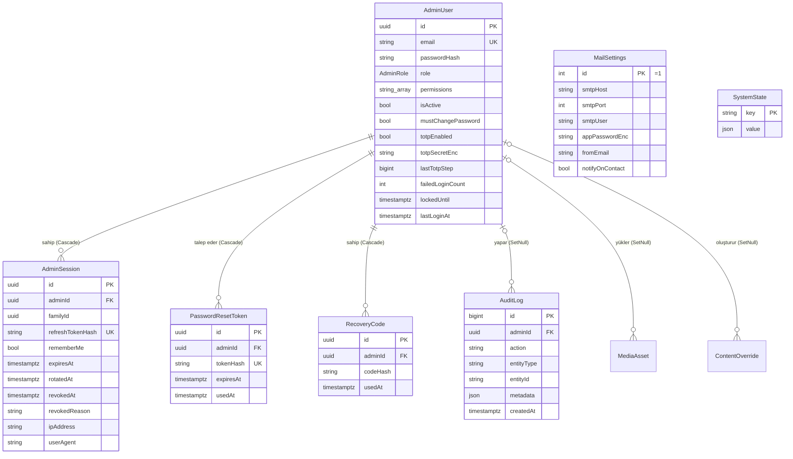
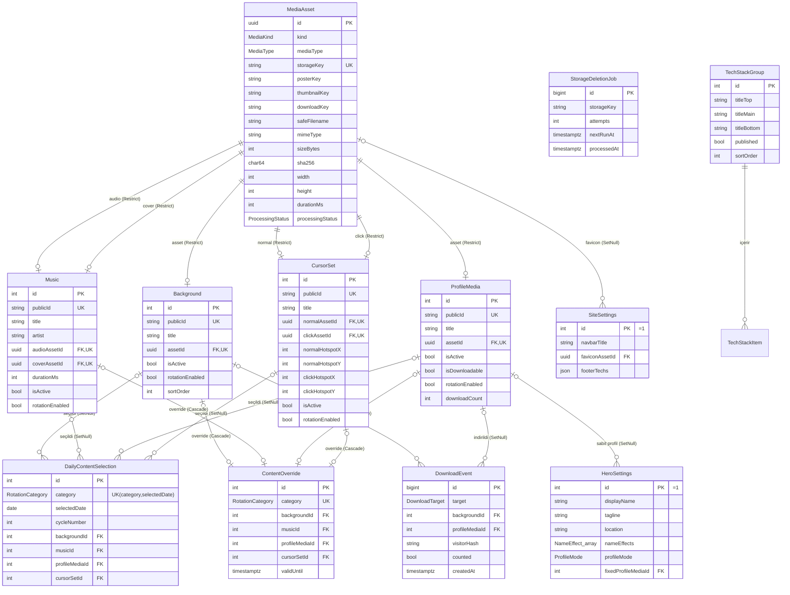
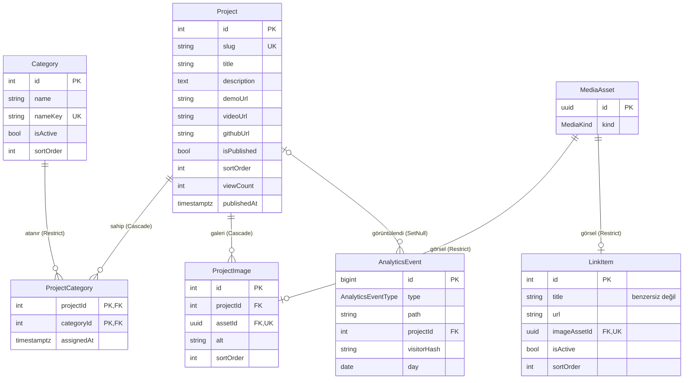
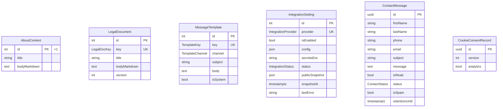

# ERD — Entity Relationship Diagram

> **Sürüm:** 1.0 · **Son güncelleme:** 2026-11-14 · Kaynak tanım: DATABASE.md §3
> Okunabilirlik için diyagram dört bölüme ayrıldı. Kardinalite: `||--o{` bire-çok, `||--o|` bire-sıfır/bir, `}o--o{` çoka-çok (ara tabloyla).

---

## 1. Kimlik, oturum ve denetim

---

## 2. Medya ve günlük rotasyon

> `MediaAsset` silme işlemi DB tarafında cascade **etmez**; fiziksel dosyalar `StorageDeletionJob` kuyruğu üzerinden servis katmanında temizlenir (DATABASE.md §5.2). Bu yüzden `StorageDeletionJob` bir FK taşımaz.

---

## 3. Projeler, kategoriler ve linkler

`Project }o--o{ Category` çoka-çok ilişkisi `ProjectCategory` ara tablosuyla modellenir (Şartname §7.2).

---

## 4. Bağımsız tablolar (FK'siz)

---

## 5. Özet ilişki tablosu

| İlişki | Tür | onDelete |
|---|---|---|
| AdminUser → AdminSession / PasswordResetToken / RecoveryCode | 1:N | Cascade |
| AdminUser → AuditLog / MediaAsset / ContentOverride | 1:N (opsiyonel) | SetNull |
| MediaAsset → içerik sahibi (Background, Music×2, ProfileMedia, CursorSet×2, ProjectImage, LinkItem) | 1:1 | Restrict |
| MediaAsset → SiteSettings (favicon) | 1:N | SetNull |
| İçerik → DailyContentSelection | 1:N | SetNull |
| İçerik → ContentOverride | 1:0..1 | Cascade |
| ProfileMedia → HeroSettings (sabit profil) | 1:N | SetNull |
| Project ↔ Category (ProjectCategory) | N:M | Project: Cascade · Category: Restrict |
| Project → ProjectImage | 1:N | Cascade |
| Background (duvar kağıdı) / ProfileMedia → DownloadEvent | 1:N | SetNull |
| Project → AnalyticsEvent | 1:N | SetNull |
